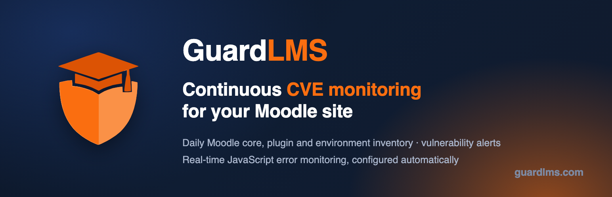

  

# GuardLMS for Moodle

Connect your Moodle site to [GuardLMS](https://guardlms.com) for vulnerability
alerts, update reminders and security configuration checks.

The plugin reports your software inventory once a day. Optional error monitoring
helps you investigate browser and server problems from the GuardLMS dashboard.

## Features

- Daily Moodle and plugin inventory for vulnerability and update monitoring.
- Security configuration checks, including MFA, reCAPTCHA and Mobile API settings.
- Optional JavaScript, PHP and SQL error reporting.
- Optional page views and scroll-depth analytics on supported plans.
- One-click connection with clear status and reconnect controls.

## Requirements

- Moodle **3.9+** and PHP **7.4+**, using a PHP version supported by your Moodle release.
- A GuardLMS account, outbound HTTPS access and working Moodle cron.
- Individual checks depend on the features available in your Moodle version.

## Install and connect

1. Install from the [Moodle plugins directory](https://moodle.org/plugins/local_guardlms)
   or through **Site administration → Plugins → Install plugins**.
2. Visit **Site administration** to complete the installation or upgrade.
3. Open **Plugins → Local plugins → GuardLMS**.
4. Click **Connect**, sign in to GuardLMS and confirm the connection.
5. Use **Open dashboard** to view your site's results.

For manual installation, place the plugin in `local/guardlms` on Moodle 3.9–5.0,
or `public/local/guardlms` on Moodle 5.1 and later.

Inventory is sent daily by cron. To send it now, run **Push site information to
GuardLMS** under **Server → Scheduled tasks**. If the plugin asks you to reconnect,
use **Reconnect** on its settings page.

## Optional monitoring

Enable only the features you need in the plugin settings:

- **Enable real-time monitoring** — JavaScript errors from the browser.
- **Enable page analytics** — page views and scroll depth; requires an eligible plan.
- **Report PHP and SQL errors** — server errors; separate opt-in, off by default.

Monitoring requires a connected site and active GuardLMS monitoring.
See [monitoring setup and data sharing](docs/monitoring.md) for details.

## Privacy

The inventory reports software, environment and selected configuration metadata.
Account records, passwords, reCAPTCHA keys and configured IP lists stay in Moodle.

Optional browser monitoring sends page URLs and diagnostic context. PHP/SQL error
reporting can also send redacted SQL and request parameters. Review the
[monitoring privacy details](docs/monitoring.md) before enabling these features,
and the [inventory reference](docs/inventory.md) for the configuration payload.

## Documentation

- [Connection, troubleshooting and advanced settings](docs/advanced-settings.md)
- [Browser monitoring, analytics and server errors](docs/monitoring.md)
- [Inventory, security checks and payload reference](docs/inventory.md)
- [Development, tests and compatibility](docs/development.md)
- [Releasing to Moodle Marketplace](docs/releases.md)

## Support and license

Report problems through [GitHub issues](https://github.com/LdesignMedia/moodle-local_guardlms/issues).
Learn more at [guardlms.com](https://guardlms.com).

Licensed under [GNU GPL v3 or later](LICENSE).
